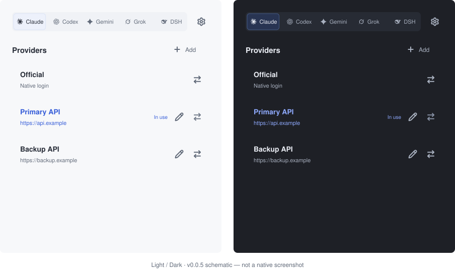

# pp-switch

**Pure Provider Switch. Your setup stays yours.**

Switch saved API connections without repeatedly editing client configuration files.
Five harnesses in the v0.0.6 preview.

**English · [简体中文](README_ZH.md) · [日本語](README_JA.md) · [Deutsch](README_DE.md)**

[Download](https://github.com/phonowell/pp-switch/releases) · [Guide](docs/user-guide.md) · [Measured performance](docs/verification.md) · [Spec](SPEC.md)

## Why pp-switch?

Switch connections while keeping your client configuration. PPS owns URL/key,
explicit optional models and scoped native/API routing; it preserves unrelated
settings, comments and formatting, and refuses unsupported configurations.

One native window, per-row Lucide Edit/Switch, no tray or resident helper.
Updates run only after a manual check and confirmation. Rust + FLTK, system fonts
and vector paths; no bundled WebView, database or JavaScript runtime.

The v0.0.6 preview supports Claude Code, Codex CLI/App, Gemini CLI, Grok Build
and DSH CLI/Web. The older v0.0.4 release supports the first three.
[Scope and cc-switch research](docs/verification.md#community-sources).

## Download

**[v0.0.6 preview](https://github.com/phonowell/pp-switch/releases/tag/v0.0.6) is published.** Four native CI targets passed, including Chinese macOS input and four-language light/dark pixel checks. [Acceptance and limits](docs/smoke.md). macOS memory remains over budget; cold startup is unverified.

| Platform | Package | Run |
| --- | --- | --- |
| macOS · Apple Silicon | [ZIP](https://github.com/phonowell/pp-switch/releases/download/v0.0.6/pp-switch-v0.0.6-aarch64-apple-darwin.zip) | Extract; move `.app` to Applications |
| macOS · Intel | [ZIP](https://github.com/phonowell/pp-switch/releases/download/v0.0.6/pp-switch-v0.0.6-x86_64-apple-darwin.zip) | Same |
| Windows · x64 | [ZIP](https://github.com/phonowell/pp-switch/releases/download/v0.0.6/pp-switch-v0.0.6-x86_64-pc-windows-msvc.zip) | Extract; run `pp-switch.exe` |
| Linux · x64 | [tar.gz](https://github.com/phonowell/pp-switch/releases/download/v0.0.6/pp-switch-v0.0.6-x86_64-unknown-linux-gnu.tar.gz) | Extract; run `pp-switch` on a desktop |

No Rust or Node.js installation required. macOS packages declare macOS 11+ and are **not Apple Developer-signed or notarized**. Windows requires Windows 10+. Linux requires X11/XWayland, X11/fontconfig libraries and a system font covering your selected language. Native test environments are listed in [verification](docs/verification.md); a declared minimum is not evidence of testing every OS version.

## Use

1. Choose a harness, click **Add**, enter name/URL/key and Save.
2. Review the optional model. Claude prefills `claude-sonnet-5` when no specific model is available; clear it to keep client models.
3. Click the row’s Switch icon. Restart the client if it does not reload configuration.

Save only stores a Provider. **In use** is blue and checks supported user-level
files, not a running session or successful request. Names are unique per client;
imports add ` (2)`, ` (3)` on collision. Identical connections may have different names.

In v0.0.6 each harness has an **Official** row for scoped native restoration.
Codex CLI/App share configuration; DSH CLI/Web share initialized home profiles.
CCS/Sub2API links open an unsaved preview; explicit models take priority over editor suggestions. Verify the suggested model is supported by your provider.
External helpers/cloud modes and unsupported key sources are refused.
[Setup, exact writes and troubleshooting](docs/user-guide.md).

Settings contains language, explicit link registration and manual updates. UI
languages: English, 简体中文, 繁體中文, 日本語; follows system light/dark appearance.
Secrets remain in user-only local files; masking is not encryption. No automatic
provider requests. Updates verify this repository’s SHA-256 packages and replace
only application-owned files. [Behavior contract](SPEC.md).

## Performance, with evidence

**0.0.6 native CI measurements:**

| Native CI | Installed MiB | Idle RSS MiB | Script budget |
| --- | ---: | ---: | --- |
| macOS 15 · ARM64 | 2.66 | 48.55 | Fail |
| macOS 15 · Intel | 2.95 | 32.41 | Fail |
| Windows Server 2022 · x64 | 3.12 | 15.21 | Fail |
| Ubuntu 22.04 · x64 · Xvfb | 3.40 | 21.20 | Fail |

All packages are below 5 MiB. macOS RSS exceeds the memory budget; cold interactive startup and update peaks remain unverified. No overall memory/startup improvement is claimed. [SPEC PP-11](SPEC.md#acceptance-contract) · [Raw data](docs/verification.md#release-006).

## Contribute

Start with [SPEC.md](SPEC.md); build, validation and release instructions live in
[CONTRIBUTING.md](CONTRIBUTING.md).

## Acknowledgments and license

Thanks to [cc-switch](https://github.com/farion1231/cc-switch) for its open-source protocol and implementation references, and to [fltk-rs](https://github.com/fltk-rs/fltk-rs) / [FLTK](https://www.fltk.org) for the native UI toolkit. pp-switch is not affiliated with cc-switch.

[MIT](LICENSE). Dependencies retain their own [licenses and notices](THIRD_PARTY_NOTICES.txt).
