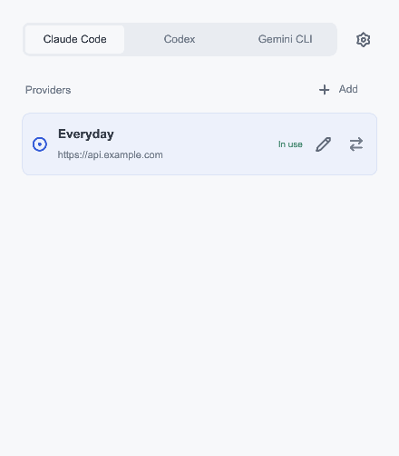

# pp-switch

**Pure Provider Switch. Deine Konfiguration bleibt deine.**

API-URL und Schlüssel für Claude Code, Codex und Gemini CLI wechseln.

**[English](README.md) · [简体中文](README_ZH.md) · [日本語](README_JA.md) · Deutsch**

[Download](https://github.com/phonowell/pp-switch/releases) · [Anleitung (Englisch)](docs/user-guide.md) · [Messwerte](docs/verification.md) · [Spezifikation](SPEC.md)

## Warum pp-switch?

**Ein anderer API-Anbieter sollte keine neue Einrichtung deines Clients erfordern.**

Modelle, Denkparameter, Projektberechtigungen, MCP und Skills sind bereits eingerichtet. Du möchtest nur eine andere URL und einen anderen Schlüssel. pp-switch speichert diese Verbindungen und ändert beim Wechsel genau diese beiden Werte. Alle anderen Konfigurationsbytes, Kommentare und Formatierungen bleiben erhalten. Nicht unterstützte Konfigurationen werden ausdrücklich abgelehnt, statt sie stillschweigend neu aufzubauen.

**Fertig mit dem Wechsel? Fertig mit der App.** Ein Fenster, kein Tray, kein Autostart, keine Anbieterabfragen oder regelmäßigen Nutzungsabfragen. Beim Schließen endet der Prozess. Updates erfolgen nur nach einem Klick auf „Check for updates“ und deiner Bestätigung. Rust + FLTK, native Vektorzeichnung und Systemschriften; kein mitgeliefertes WebView, keine Datenbank und keine JavaScript-Laufzeit.

[cc-switch #7649](https://github.com/farion1231/cc-switch/issues/7649) fordert einen Pure-/Lite-Modus: „CC Switch only manages fields it owns. Everything else belongs to the target application/user.“ pp-switch setzt dieses Prinzip mit einem noch engeren Umfang um: URL und Schlüssel. Die Diskussion begründet den Bedarf, ist aber keine Empfehlung für dieses Projekt. [Quellen und Grenzen](docs/verification.md#community-sources).

## Kleiner Umfang, klare Unterschiede

| | pp-switch | cc-switch |
| --- | --- | --- |
| Zweck | URL-/Schlüsselwechsel für bereits eingerichtete Clients | Umfassendere Anbieter- und Clientverwaltung |
| Schreibzugriffe | Nur wirksame Base URL und API-Schlüssel | Weitere Einstellungen je nach aktivierter Funktion |
| Anbieterlinks | Nicht angeboten | Vollständige Deep-Link-Abläufe |
| Modelle, Routing, Nutzung, MCP, Prompts, Skills | Außerhalb des Produktumfangs | Entsprechende Verwaltungsfunktionen |
| Lebenszyklus | Fenster schließen → Prozess endet | Tray und weitere Arbeitsabläufe |
| Updates | Manuell prüfen → bestätigen → herunterladen, installieren, neu starten | Eigener Updateablauf |

Für eine umfassende Verwaltungsoberfläche eignet sich [cc-switch](https://github.com/farion1231/cc-switch) besser. pp-switch ist unabhängig und richtet sich an Menschen, deren Clients bereits eingerichtet sind und die einen kleinen, vorhersehbaren Wechsel wünschen.

## Download

**0.0.4 ist ein Kandidat zur Prüfung, ohne Tag oder Veröffentlichung.** Siehe [Prüfbelege](docs/verification.md#review-candidate-004). Die Downloads unten bleiben die veröffentlichte Vorschau 0.0.3.

**Die UI-Überarbeitung von 0.0.4 wurde am 2026-10-12 abgenommen. Die Veröffentlichung ist genehmigt; native Release-CI steht noch aus.** Chinesische native Eingaben und alle Sprachstile werden getrennt geprüft; [Nachweise](docs/smoke.md).

**[v0.0.3 Funktionsvorschau](https://github.com/phonowell/pp-switch/releases/tag/v0.0.3)**. macOS überschreitet das Speicherbudget; [Messwerte](docs/verification.md) sind öffentlich.

| Plattform | Paket | Start |
| --- | --- | --- |
| macOS · Apple Silicon | [ZIP](https://github.com/phonowell/pp-switch/releases/download/v0.0.3/pp-switch-v0.0.3-aarch64-apple-darwin.zip) | Entpacken, `.app` nach Applications verschieben |
| macOS · Intel | [ZIP](https://github.com/phonowell/pp-switch/releases/download/v0.0.3/pp-switch-v0.0.3-x86_64-apple-darwin.zip) | Ebenso |
| Windows · x64 | [ZIP](https://github.com/phonowell/pp-switch/releases/download/v0.0.3/pp-switch-v0.0.3-x86_64-pc-windows-msvc.zip) | Entpacken, `pp-switch.exe` starten |
| Linux · x64 | [tar.gz](https://github.com/phonowell/pp-switch/releases/download/v0.0.3/pp-switch-v0.0.3-x86_64-unknown-linux-gnu.tar.gz) | Entpacken, `pp-switch` auf einem Desktop starten |

Rust oder Node.js werden zum Ausführen nicht benötigt. macOS-Pakete deklarieren macOS 11+, sind aber **nicht mit Apple Developer signiert oder notarisiert**. Windows benötigt Windows 10+. Linux benötigt X11/XWayland, X11-/fontconfig-Bibliotheken und Systemschriften für die gewählte Sprache. Mindestversionen bedeuten nicht, dass jede OS-Version getestet wurde; siehe [Testumgebungen](docs/verification.md).

Unter macOS ist von 0.0.2 einmal ein manueller Download nötig: Der alte Updater lehnt die neue Icon-Ressource ab. 0.0.3 berücksichtigt sie bei Updates.

## Verwendung

1. Claude Code, Codex oder Gemini CLI wählen.
2. „Add“ wählen, Name, Base URL und Schlüssel eingeben und speichern.
3. Das Wechselsymbol rechts neben dem Stift in derselben Zeile anklicken.

Jede Zeile hat Lucide-Symbole zum Bearbeiten und Wechseln; Auswahl allein wendet
nichts an. Das kleine Zahnrad neben den Tabs öffnet Einstellungen für Sprache und
manuelle Updates. Tooltips, Inhaltsüberschrift, unterer Status/Wechselbereich und
Linkimport entfallen. Alle passenden Duplikate zeigen „In use“. Die Oberfläche
folgt dem hellen/dunklen Systemmodus. Speichern betrifft nur die lokale Liste.
UI: **English, 简体中文, 繁體中文 und 日本語**; Deutsch ist eine Dokumentationssprache.

| Client | Erforderliche bestehende Einrichtung | Geänderte Werte |
| --- | --- | --- |
| Claude Code | API-Schlüssel ohne externen Key-Helper, Cloudmodus oder mehrdeutige Zugangsdaten | `ANTHROPIC_BASE_URL` und vorhandenes Schlüssel-/Tokenfeld in `settings.json` |
| Codex | Benutzerdefinierter Anbieter ausgewählt, API-Schlüsselauthentifizierung eingerichtet | Aktueller `base_url` und vorhandenes Bearer-Token oder `auth.json.OPENAI_API_KEY` |
| Gemini CLI | API-Schlüsselmodus bereits über `/auth` gewählt | `GOOGLE_GEMINI_BASE_URL` und `GEMINI_API_KEY` in `.env` |

Keine Änderungen an Modellen, Authentifizierungsart oder Protokoll, keine Ersteinrichtung. Nur Benutzerdateien; Projektkonfiguration, Startargumente und Umgebungsvariablen eines anderen Terminals können Vorrang haben. `CLAUDE_CONFIG_DIR` und `CODEX_HOME` werden berücksichtigt. [Einrichtung und Fehlerhilfe (Englisch) →](docs/user-guide.md)

## Kompatibilität und Vertrauen

- Der aktuelle Kandidat bietet keinen Linkimport oder URL-Registrierung. Gespeicherte Einträge bleiben erhalten.
- Geheimnisse bleiben in lokalen Benutzerdateien (Unix 0600 / Windows-ACL für den aktuellen Benutzer). Maskierung ist **keine Verschlüsselung**. Keine automatischen Zwischenablagezugriffe, Geheimnisse in Diagnosen oder Anfragen an Anbieter.
- Updates benötigen deine Bestätigung und einen beschreibbaren Installationsort. Nur Pakete dieses Repositorys werden heruntergeladen und per SHA-256 geprüft. Sie sind unsigniert; Anbieter- und Clientdateien bleiben außerhalb des Updaters. [Updatedetails (Englisch)](docs/user-guide.md#manual-update).
- Vollständiger Vertrag: [SPEC.md](SPEC.md); Datei- und Datenpfade: [Anleitung](docs/user-guide.md).

## Leistung mit Belegen

**Native CI-Messungen für 0.0.3:**

| Native CI | Installiert MiB | Leerlauf-RSS MiB | Skriptbudget |
| --- | ---: | ---: | --- |
| macOS 15 · ARM64 | 2.51 | 66.64 | Nicht bestanden |
| macOS 15 · Intel | 2.73 | 38.40 | Nicht bestanden |
| Windows Server 2022 · x64 | 2.81 | 15.00 | Bestanden |
| Ubuntu 22.04 · x64 · Xvfb | 3.02 | 17.19 | Bestanden |

Die Budgets stehen in [SPEC PP-11](SPEC.md#acceptance-contract). Windows/Linux
bestehen dieses Skript; macOS überschreitet das Speicherbudget. Echter Kaltstart
sowie Import-/Updatespitzen sind nicht bestätigt. [Methode, Rohdaten und frühere Ergebnisse](docs/verification.md).

## Mitwirken

Beginne mit [SPEC.md](SPEC.md). Build-, Prüf- und Releaseanweisungen stehen im
[Beitragsleitfaden (Englisch)](CONTRIBUTING.md).

## Dank und Lizenz

Danke an [cc-switch](https://github.com/farion1231/cc-switch) für offene Protokoll- und Implementierungsreferenzen und an [fltk-rs](https://github.com/fltk-rs/fltk-rs) / [FLTK](https://www.fltk.org). pp-switch ist nicht mit cc-switch verbunden. [MIT](LICENSE). Abhängigkeiten behalten ihre [Lizenzen und Hinweise](THIRD_PARTY_NOTICES.txt).
