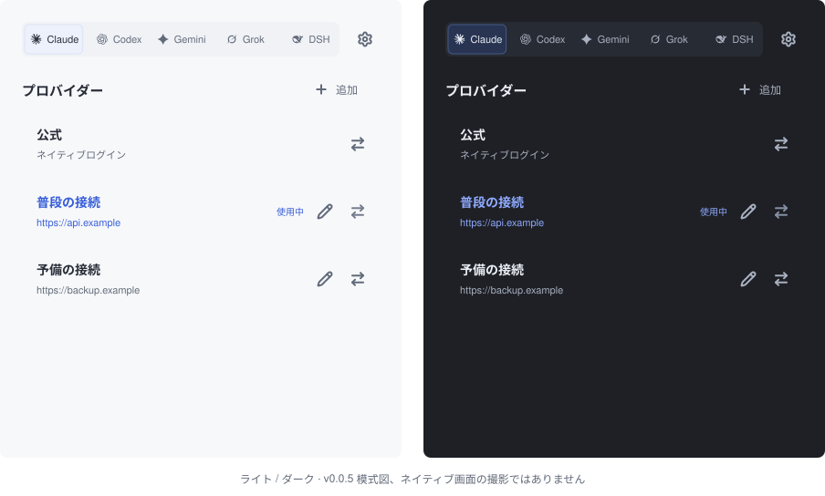

# pp-switch

**Pure Provider Switch. 設定は、あなたのまま。**

小さなネイティブ接続切り替えアプリ。0.0.5 開発版は五つの harness に対応。

**[English](README.md) · [简体中文](README_ZH.md) · 日本語 · [Deutsch](README_DE.md)**

[ダウンロード](https://github.com/phonowell/pp-switch/releases) · [ガイド](docs/user-guide-ja.md) · [実測結果](docs/verification.md) · [仕様](SPEC.md)

## なぜ pp-switch？

クライアント設定を保ちながら接続先を切り替えます。URL・キー、明示した任意の
モデルと限定的な公式/API 経路だけを管理し、その他の設定・コメント・書式は維持。
非対応の構成は変更せず拒否します。

ネイティブウィンドウ一つ、各行に Lucide 編集/切り替え。トレイや常駐ヘルパーは
ありません。更新は手動確認と承認後だけ。Rust + FLTK、システムフォント、ベクター描画。
WebView・データベース・JavaScript ランタイムは同梱しません。

開発版は Claude Code、Codex CLI/App、Gemini CLI、Grok Build、DSH CLI/Web に対応。
**公開済み 0.0.4 は最初の三つのみ。0.0.5 は未公開です。**
[範囲と cc-switch 調査](docs/verification.md#community-sources)。

## ダウンロード

**0.0.4 は 2026-10-12 にユーザー承認・公開済みです。** 中国語の機能と全言語の外観を検証。[確認記録](docs/smoke.md)。

**[v0.0.4 機能プレビュー](https://github.com/phonowell/pp-switch/releases/tag/v0.0.4)**。macOS のメモリは予算超過です。[実測結果](docs/verification.md) を公開しています。

| OS | パッケージ | 実行 |
| --- | --- | --- |
| macOS · Apple Silicon | [ZIP](https://github.com/phonowell/pp-switch/releases/download/v0.0.4/pp-switch-v0.0.4-aarch64-apple-darwin.zip) | 展開し `.app` を Applications へ |
| macOS · Intel | [ZIP](https://github.com/phonowell/pp-switch/releases/download/v0.0.4/pp-switch-v0.0.4-x86_64-apple-darwin.zip) | 同上 |
| Windows · x64 | [ZIP](https://github.com/phonowell/pp-switch/releases/download/v0.0.4/pp-switch-v0.0.4-x86_64-pc-windows-msvc.zip) | 展開し `pp-switch.exe` を実行 |
| Linux · x64 | [tar.gz](https://github.com/phonowell/pp-switch/releases/download/v0.0.4/pp-switch-v0.0.4-x86_64-unknown-linux-gnu.tar.gz) | 展開しデスクトップで `pp-switch` を実行 |

Rust / Node.js のインストールは不要。macOS は 11+ を宣言していますが、**Apple Developer 署名・公証はありません**。Windows は 10+。Linux は X11/XWayland、X11/fontconfig ライブラリ、選択した言語を表示できるシステムフォントが必要です。宣言された最小 OS はすべてのバージョンの動作確認を意味しません。[検証環境](docs/verification.md) を参照してください。

## 使い方

1. harness を選び、追加から名前・URL・キーを入力して保存。
2. 任意のモデルを確認。Claude は具体的なモデルがない場合 `claude-sonnet-5` を事前入力し、空欄にするとクライアントのモデルを維持します。
3. その行の切り替えアイコンを押し、設定を再読込しない場合はクライアントを再起動。

保存は一覧だけを変更します。青い「使用中」は対応ユーザー設定ファイルの一致を
示し、実行中のセッションやリクエスト成功を保証しません。名前はクライアントごとに
一意。重複インポートは ` (2)`、` (3)` を付け、同じ接続も別名で保存できます。

0.0.5 の五つの harness に「公式」行があり、限定的にネイティブ経路を復元します。
Codex CLI/App は設定を共有し、DSH CLI/Web は初期化済みの home profile を共有。
CCS/Sub2API リンクは未保存プレビューを開き、明示したモデルは編集画面の候補より優先します。候補がプロバイダーに対応しているか確認してください。
外部キーヘルパー・クラウド認証・非対応キーソースは拒否。
[初期設定・書き込み対象・問題対処](docs/user-guide-ja.md)。

設定には言語、明示的なリンク登録、手動更新があります。English・简体中文・繁體中文・
日本語とシステムのライト/ダークに対応。キーはユーザー限定のローカルファイルに保存し、
マスクは暗号化ではありません。自動サービス通信はせず、更新は本リポジトリの
SHA-256 を検証し、アプリ所有ファイルだけを置換。[動作仕様](SPEC.md)。

## 性能を公開する

**0.0.4 ネイティブ CI 実測：**

| ネイティブ CI | 容量 MiB | アイドル RSS MiB | スクリプト予算 |
| --- | ---: | ---: | --- |
| macOS 15 · ARM64 | 2.43 | 48.44 | 未達 |
| macOS 15 · Intel | 2.67 | 31.97 | 未達 |
| Windows Server 2022 · x64 | 2.78 | 15.08 | 合格 |
| Ubuntu 22.04 · x64 · Xvfb | 3.01 | 16.96 | 未達 |

Windows は両シナリオに合格。macOS はメモリ予算超過。Linux は空ウィンドウに合格し、エディターのアイドル予算は超過。厳密なコールド起動と更新ピークは未検証です。 [SPEC PP-11](SPEC.md#acceptance-contract) · [Raw data](docs/verification.md#release-004).

## 開発

[SPEC.md](SPEC.md) を先に確認してください。ビルド・検証・リリース手順は
[貢献ガイド（英語）](CONTRIBUTING.md) にまとめています。

## 謝辞とライセンス

[cc-switch](https://github.com/farion1231/cc-switch) の公開プロトコル・実装資料、[fltk-rs](https://github.com/fltk-rs/fltk-rs) / [FLTK](https://www.fltk.org) に感謝します。cc-switch とは独立したプロジェクトです。[MIT](LICENSE)。依存の[ライセンスと通知](THIRD_PARTY_NOTICES.txt) を保持します。
