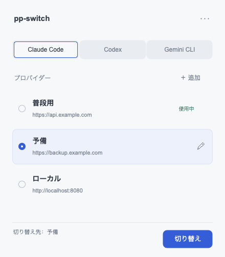

<div align="center">


# pp-switch

**Pure Provider Switch. 設定は、あなたのまま。**

Claude Code・Codex・Gemini CLI の API URL とキーを切り替える小さなアプリ。

[](https://github.com/phonowell/pp-switch/actions/workflows/ci.yml)
[](LICENSE)


**[English](README.md) · [简体中文](README_ZH.md) · 日本語 · [Deutsch](README_DE.md)**

[ダウンロード](https://github.com/phonowell/pp-switch/releases) · [ガイド](docs/user-guide-ja.md) · [実測結果](docs/verification.md) · [仕様](SPEC.md)

</div>



## pp-switch を選ぶ理由

**API サービスを変えるたびに、調整済みのクライアントを設定し直したくない。**

モデル、推論設定、プロジェクト権限、MCP、Skills はすでに使いやすく整っています。変えたいのは URL とキーだけ。pp-switch は接続を保存し、切り替え時にその二つの値だけを変更します。無関係な設定のバイト列、コメント、書式は維持します。非対応の設定は明示的に拒否し、勝手に作り直しません。

**使い終わったら、終了する。** 一つのウィンドウ。トレイ、スタートアップ常駐、プロバイダーへの疎通確認、使用量の定期取得はありません。閉じるとプロセスが終了します。更新も「更新を確認」を押してインストールに同意した場合だけ。Rust + FLTK、ネイティブのベクター描画とシステムフォントを使い、WebView・データベース・JavaScript ランタイムを同梱しません。

**今あるリンクを使える。** 対応する `ccswitch://` プロバイダーリンクを貼り付け、URL とキーを確認して保存・切り替え。モデルやツールの追加設定はクライアントに書き込みません。

[cc-switch #7649](https://github.com/farion1231/cc-switch/issues/7649) でも Pure/Lite モードと「管理対象以外の設定はアプリやユーザーに任せる」ことが求められています。pp-switch はこの設定の所有原則を URL とキーに限定して実装します。議論は着想の根拠であり、推薦を意味しません。[調査資料と留意点](docs/community.md)。

## 小さな範囲、明確な違い

| | pp-switch | cc-switch |
| --- | --- | --- |
| 目的 | 設定済みクライアントの URL / キー切り替え | より広いプロバイダー・クライアント管理 |
| 書き込み | 現在有効な Base URL と API キーのみ | 有効な機能に応じてより多くの設定 |
| リンク | 対応するインポート部分を貼り付け | 完全なディープリンク機能 |
| モデル、ルーティング、使用量、MCP、プロンプト、Skills | 製品の範囲外 | 対応する管理機能 |
| 終了 | ウィンドウを閉じるとプロセス終了 | トレイなどのワークフロー |
| 更新 | 手動確認 → 同意 → ダウンロード・インストール・再起動 | 独自の更新機能 |

総合管理には [cc-switch](https://github.com/farion1231/cc-switch) が適しています。pp-switch は独立したプロジェクトで、設定済みのクライアントを小さく予測可能な操作で切り替えたい人向けです。

## ダウンロード

**[v0.0.3 機能プレビュー](https://github.com/phonowell/pp-switch/releases/tag/v0.0.3)**：小さなフラット UI、PPC アプリアイコン、4 言語、手動更新。macOS のアイドルメモリは予算を超えています。Windows と Linux は現在の測定スクリプトに合格。「20 MiB」と宣伝せず、[実際の検証記録](docs/verification.md) を公開します。

| OS | パッケージ | 実行 |
| --- | --- | --- |
| macOS · Apple Silicon | [ZIP](https://github.com/phonowell/pp-switch/releases/download/v0.0.3/pp-switch-v0.0.3-aarch64-apple-darwin.zip) | 展開し `.app` を Applications へ |
| macOS · Intel | [ZIP](https://github.com/phonowell/pp-switch/releases/download/v0.0.3/pp-switch-v0.0.3-x86_64-apple-darwin.zip) | 同上 |
| Windows · x64 | [ZIP](https://github.com/phonowell/pp-switch/releases/download/v0.0.3/pp-switch-v0.0.3-x86_64-pc-windows-msvc.zip) | 展開し `pp-switch.exe` を実行 |
| Linux · x64 | [tar.gz](https://github.com/phonowell/pp-switch/releases/download/v0.0.3/pp-switch-v0.0.3-x86_64-unknown-linux-gnu.tar.gz) | 展開しデスクトップで `pp-switch` を実行 |

Rust / Node.js のインストールは不要。macOS は 11+ を宣言していますが、**Apple Developer 署名・公証はありません**。Windows は 10+。Linux は X11/XWayland、X11/fontconfig ライブラリ、選択した言語を表示できるシステムフォントが必要です。宣言された最小 OS はすべてのバージョンの動作確認を意味しません。[検証環境](docs/verification.md) を参照してください。

macOS 0.0.2 からは今回だけ手動ダウンロードが必要です。旧版は追加のアイコン資源を拒否します。0.0.3 の更新対象にはアイコンを含めています。

## 使い方

1. Claude Code、Codex、Gemini CLI を選択。
2. 「追加」から名前・Base URL・API キーを入力、またはリンクを取り込む。
3. 「保存」して「切り替え」。設定を再読込しないクライアントは再起動。

選択項目の鉛筆ボタンで編集。インポート・言語・手動更新は「その他」にまとめています。保存は pp-switch 内のみ、切り替えはクライアントの URL とキーのみを変更します。UI は **English・简体中文・繁體中文・日本語**。初回はシステム言語を検出し、編集内容を失わず即時変更できます。

| クライアント | 必要な既存設定 | 変更する値 |
| --- | --- | --- |
| Claude Code | 外部 key helper、クラウドモード、競合する認証情報のない API キー設定 | `settings.json` の `ANTHROPIC_BASE_URL` と既存キー/token |
| Codex | カスタムプロバイダー選択済み、API キー認証設定済み | 選択プロバイダーの `base_url` と既存 bearer token または `auth.json.OPENAI_API_KEY` |
| Gemini CLI | `/auth` で API キーモード選択済み | `.env` の `GOOGLE_GEMINI_BASE_URL` と `GEMINI_API_KEY` |

モデル・認証方式・プロトコルの変更や初期設定はしません。ユーザー設定だけが対象で、プロジェクト設定・起動引数・別ターミナルの環境変数が優先される場合があります。`CLAUDE_CONFIG_DIR`、`CODEX_HOME` に対応。[詳細・トラブル対処 →](docs/user-guide-ja.md)

## 互換性と信頼

- `ccswitch://v1/import?resource=provider` / `ppswitch://` の **Provider インポート部分**に対応。claude/codex/gemini、直接パラメーター、Base64 内の JSON/TOML。最初の URL を使用。別リソースやリモート設定のみのリンクは拒否。
- ウィンドウへ貼り付けて使用。cc-switch の DB 共有や OS の URL 関連付けはありません。
- 秘密はローカルのユーザー専用ファイル（Unix 0600 / Windows 現在ユーザー ACL）に保存。マスク表示は**暗号化ではありません**。自動クリップボード読取、秘密の診断出力、プロバイダーへの通信はありません。
- 更新通信は本リポジトリの GitHub Releases のみ。バージョンに同意してからダウンロード・インストール・再起動。サイズと対象ファイルを制限し、GitHub の SHA-256 摘要で検証。失敗時は復元し、外部編集と競合すればバックアップを保持。未署名のため摘要は転送の完全性確認であり、独立した発行者署名ではありません。書き込み可能な設置先が必要。プロバイダーやクライアント設定は更新しません。
- 完全な動作契約は [SPEC.md](SPEC.md)、保存先は[ガイド](docs/user-guide-ja.md)。

## 性能を公開する

| 予算 | 目標 |
| --- | ---: |
| アプリ所有ファイルのインストール容量 | ≤5 MiB |
| アイドル時の総 RSS | ≤20 MiB |
| 起動 / インポート時のピーク総 RSS | ≤30 MiB |
| コールド起動から操作可能まで | ≤300 ms |
| 閉じた後 | プロセス終了 |

**目標であり、達成済みの宣伝文句ではありません。** 0.0.1 の CI 基準値は容量 1.32–1.52 MiB、アイドル RSS は macOS ARM64 68.08 MiB、macOS Intel 40.24 MiB、Windows 15.10 MiB、Linux/Xvfb 8.77 MiB。ローカル M4 / macOS 27 では約 121 MiB。過去の基準値であり、0.0.3 の測定値や制御された OS 比較ではありません。

**0.0.3 ネイティブ CI 実測：**

| ネイティブ CI | 容量 MiB | アイドル RSS MiB | スクリプト予算 |
| --- | ---: | ---: | --- |
| macOS 15 · ARM64 | 2.51 | 66.64 | 未達 |
| macOS 15 · Intel | 2.73 | 38.40 | 未達 |
| Windows Server 2022 · x64 | 2.81 | 15.00 | 合格 |
| Ubuntu 22.04 · x64 · Xvfb | 3.02 | 17.19 | 合格 |

[現行版の結果・生データ・測定方法](docs/verification.md) を公開しています。キャッシュを保持した新規プロセスのイベントループ準備時間は、厳密なコールド起動・入力遅延・大量インポートのピークを保証しません。予算違反は CI に残し、閾値は緩和していません。

## 開発とライセンス

[SPEC.md](SPEC.md) を先に更新し、最小の実装と観測可能な動作を検証します。Rust ≥1.89、CMake、C++ ツールチェーンが必要。Linux 依存は [CI](.github/workflows/ci.yml) に記載。

```sh
cargo run --locked
cargo fmt --check
cargo clippy --locked --all-targets -- -D warnings
cargo test --locked
cargo build --locked --release --bins --examples
cargo run --locked --example ui_smoke
cargo run --locked --example update_smoke
python3 scripts/measure.py target/release/examples/measure_ui --output target/metrics.json --enforce
```

GUI / 更新検証は一時ファイルのみを使用。Linux は `xvfb-run -a`、Windows の実行例は `.exe` 付き。スクリーンショットはサンプルデータで、アプリには同梱しません。

[cc-switch](https://github.com/farion1231/cc-switch) の公開プロトコル・実装資料、[fltk-rs](https://github.com/fltk-rs/fltk-rs) / [FLTK](https://www.fltk.org) に感謝します。cc-switch とは独立したプロジェクトです。[MIT](LICENSE)。依存の[ライセンスと通知](THIRD_PARTY_NOTICES.txt) を保持します。
