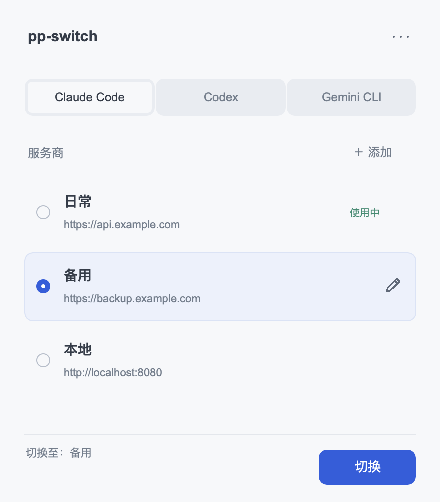

# pp-switch

**Pure Provider Switch. 只切地址和 Key，配置始终归你。**

为 Claude Code、Codex 和 Gemini CLI 准备的极简服务商切换器。

**[English](README.md) · 简体中文 · [日本語](README_JA.md) · [Deutsch](README_DE.md)**

[下载](https://github.com/phonowell/pp-switch/releases) · [使用指南](docs/user-guide-zh.md) · [性能实测](docs/verification.md) · [行为规范](SPEC.md)

## 为什么选 pp-switch？

**好不容易调好的客户端，不应该因为换个 API 服务就重配一遍。**

模型、推理参数、项目权限、MCP、Skills 都已经顺手了。你现在只想换一个地址和 Key。pp-switch 保存这些连接，切换时只修改这两个值；无关配置的原始字节、注释和格式都保留。不支持的配置会明确提示，不会替你重新搭一套。

**切换器，用完就该结束。** 一个窗口，没有托盘、开机启动、服务探测和用量轮询。关掉窗口，进程退出。更新也只在你点击「检查更新」并确认安装后执行。Rust + FLTK，原生矢量绘制与系统字体，不捆绑 WebView、数据库或 JavaScript 运行时。

这不是凭空想象的需求：[cc-switch #7649](https://github.com/farion1231/cc-switch/issues/7649) 明确希望提供「纯净版 / Lite 模式」，提出「CC Switch 只负责‘切换’，其他配置完全交给对应 CLI / IDE / 用户自己管理」。pp-switch 采用这个配置归属原则，并进一步收窄到地址和 Key。该讨论是需求来源，不代表社区背书；具体来源和限制见[调研记录](docs/verification.md#community-sources)。

## 边界小，差异明确

| | pp-switch | cc-switch |
| --- | --- | --- |
| 定位 | 为已经配好的客户端切换地址和 Key | 更全面的服务商与客户端管理 |
| 写入范围 | 仅当前生效的 Base URL 和 API Key | 根据启用功能管理更多配置 |
| 服务商链接 | 仅预览 URL / Key（0.0.5 开发版） | 完整深链工作流 |
| 模型、路由、用量、MCP、提示词、Skills | 不在产品范围内 | 提供相应管理能力 |
| 运行方式 | 关闭窗口，进程退出 | 支持托盘及更多工作流 |
| 更新 | 手动检查 → 确认 → 下载、安装、重启 | 自有更新工作流 |

需要综合管理面板时，[cc-switch](https://github.com/farion1231/cc-switch) 更合适。pp-switch 是独立项目，面向已经配置好客户端、希望切换动作更小、更可控的人。

## 下载

**0.0.4 已于 2026-10-12 通过用户验收并发布。** 中文功能与四种语言样式分别验证；见[验收记录](docs/smoke.md)。

**[v0.0.4 功能预览](https://github.com/phonowell/pp-switch/releases/tag/v0.0.4)**。macOS 内存仍超预算，[完整实测](docs/verification.md)公开可查。

| 平台 | 下载 | 使用 |
| --- | --- | --- |
| macOS · Apple Silicon | [ZIP](https://github.com/phonowell/pp-switch/releases/download/v0.0.4/pp-switch-v0.0.4-aarch64-apple-darwin.zip) | 解压，将 `.app` 移到 Applications |
| macOS · Intel | [ZIP](https://github.com/phonowell/pp-switch/releases/download/v0.0.4/pp-switch-v0.0.4-x86_64-apple-darwin.zip) | 同上 |
| Windows · x64 | [ZIP](https://github.com/phonowell/pp-switch/releases/download/v0.0.4/pp-switch-v0.0.4-x86_64-pc-windows-msvc.zip) | 解压，运行 `pp-switch.exe` |
| Linux · x64 | [tar.gz](https://github.com/phonowell/pp-switch/releases/download/v0.0.4/pp-switch-v0.0.4-x86_64-unknown-linux-gnu.tar.gz) | 解压，在桌面运行 `pp-switch` |

无需安装 Rust 或 Node.js。macOS 包声明支持 macOS 11+，**未进行 Apple Developer 签名或公证**。Windows 要求 Windows 10+；Linux 需要 X11/XWayland、系统 X11/fontconfig 库及覆盖所选语言的系统字体。声明最低系统版本不代表每个版本均已测试；原生验收环境见[验证记录](docs/verification.md)。

macOS 0.0.2 用户需手动下载这次更新：旧版更新器会拒绝新增的图标资源，0.0.3 已将它纳入更新文件列表。

## 使用

1. 选择 Claude Code、Codex 或 Gemini CLI。
2. 点击「添加」，填写名称、Base URL 和 Key，保存。
3. 点击该行编辑按钮后面的切换图标；客户端若未重读配置，请重启。

每行提供 Lucide 编辑和切换图标，取消独立选中态。标签右侧的小齿轮进入设置页，
管理语言与手动更新。移除了全部悬浮提示、内容标题、底部状态与全局切换区。
匹配的重复条目均显示「使用中」。界面跟随系统浅色／深色模式。保存只改本地列表。
界面语言：**English、简体中文、繁體中文、日本語**，首次跟随系统语言。

| 客户端 | 已有配置要求 | 修改字段 |
| --- | --- | --- |
| Claude Code | API Key 配置，无外部 Key helper、云平台模式或冲突凭据 | `settings.json` 中的 `ANTHROPIC_BASE_URL` 和既有 Key/token 字段 |
| Codex | 已选自定义服务商，已初始化 API Key 认证 | 当前服务商的 `base_url`，以及既有 bearer token 或 `auth.json.OPENAI_API_KEY` |
| Gemini CLI | 已通过 `/auth` 选择 API Key 模式 | `.env` 的 `GOOGLE_GEMINI_BASE_URL` 和 `GEMINI_API_KEY` |

不改变模型、认证方式或协议，也不做客户端首次初始化。只操作用户级文件；项目配置、启动参数和另一个终端的环境变量仍可能覆盖它。支持 `CLAUDE_CONFIG_DIR` 和 `CODEX_HOME`。[配置与排错 →](docs/user-guide-zh.md)

## 兼容与信任

- 0.0.5 开发版恢复仅提取服务商 URL / Key 的链接预览与显式 URL 注册；保存不会应用客户端配置。0.0.4 下载版不含此流程。
- 密钥保存在本地用户专属文件中（Unix 0600 / Windows 当前用户 ACL）。界面遮罩**不是加密**。不自动读取剪贴板、不输出密钥诊断、不请求服务商接口。
- 更新须手动确认，安装目录须可写。只下载本仓库发布包并校验 SHA-256；包未签名，更新不修改服务商和客户端配置。[更新详情](docs/user-guide-zh.md#手动更新)。
- 完整行为见 [SPEC.md](SPEC.md)；文件位置与数据目录见[指南](docs/user-guide-zh.md)。

## 性能：预算与实测分开

**0.0.4 原生 CI 实测：**

| 原生 CI | 安装大小 MiB | 空闲 RSS MiB | 脚本预算 |
| --- | ---: | ---: | --- |
| macOS 15 · ARM64 | 2.43 | 48.44 | 失败 |
| macOS 15 · Intel | 2.67 | 31.97 | 失败 |
| Windows Server 2022 · x64 | 2.78 | 15.08 | 通过 |
| Ubuntu 22.04 · x64 · Xvfb | 3.01 | 16.96 | 失败 |

Windows 两种场景均通过；macOS 内存超预算。Linux 空窗口通过，编辑器空闲内存超预算。严格冷启动和更新峰值仍未验证。 [SPEC PP-11](SPEC.md#acceptance-contract) · [Raw data](docs/verification.md#release-004).

## 参与开发

先从 [SPEC.md](SPEC.md) 开始；构建、验证和发布流程统一见
[贡献指南（英文）](CONTRIBUTING.md)。

## 致谢与许可

感谢 [cc-switch](https://github.com/farion1231/cc-switch) 的开源协议与实现参考，以及 [fltk-rs](https://github.com/fltk-rs/fltk-rs) / [FLTK](https://www.fltk.org) 的原生 UI 工具包。pp-switch 与 cc-switch 无隶属关系。

[MIT](LICENSE)。依赖保留各自[许可证与声明](THIRD_PARTY_NOTICES.txt)。
