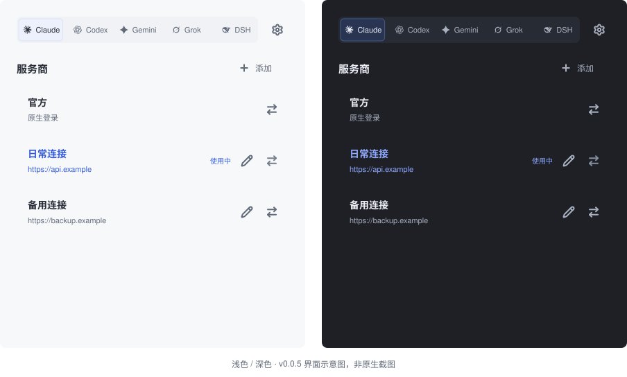

# pp-switch

**Pure Provider Switch. 明确切换连接，配置始终归你。**

保存 API 连接并一键切换，省去反复手动编辑客户端配置。
0.0.6 预览版支持五个 harness。

**[English](README.md) · 简体中文 · [日本語](README_JA.md) · [Deutsch](README_DE.md)**

[下载](https://github.com/phonowell/pp-switch/releases) · [使用指南](docs/user-guide-zh.md) · [性能实测](docs/verification.md) · [行为规范](SPEC.md)

## 为什么选 pp-switch？

切换连接，保留已经调好的客户端配置。PPS 只管理地址、Key、明确填写的可选模型
及限定的官方/API 路由；保留其他设置、注释和格式，拒绝不受支持的配置。

一个原生窗口，每行提供 Lucide 编辑/切换按钮，没有托盘或常驻助手。
更新只在手动检查并确认后执行。Rust + FLTK、系统字体和矢量路径，
不捆绑 WebView、数据库或 JavaScript 运行时。

0.0.6 预览版支持 Claude Code、Codex CLI/App、Gemini CLI、Grok Build 和 DSH CLI/Web。
较早的 0.0.4 版本仅支持前三者。
[产品边界与 cc-switch 调研](docs/verification.md#community-sources)。

## 下载

**[v0.0.6 预览版](https://github.com/phonowell/pp-switch/releases/tag/v0.0.6) 已发布。** 四个平台原生 CI 通过，包括 macOS 中文输入与四语言浅／深色像素检查。[验收与限制](docs/smoke.md)。macOS 内存仍超预算，冷启动尚未验证。

| 平台 | 下载 | 使用 |
| --- | --- | --- |
| macOS · Apple Silicon | [ZIP](https://github.com/phonowell/pp-switch/releases/download/v0.0.6/pp-switch-v0.0.6-aarch64-apple-darwin.zip) | 解压，将 `.app` 移到 Applications |
| macOS · Intel | [ZIP](https://github.com/phonowell/pp-switch/releases/download/v0.0.6/pp-switch-v0.0.6-x86_64-apple-darwin.zip) | 同上 |
| Windows · x64 | [ZIP](https://github.com/phonowell/pp-switch/releases/download/v0.0.6/pp-switch-v0.0.6-x86_64-pc-windows-msvc.zip) | 解压，运行 `pp-switch.exe` |
| Linux · x64 | [tar.gz](https://github.com/phonowell/pp-switch/releases/download/v0.0.6/pp-switch-v0.0.6-x86_64-unknown-linux-gnu.tar.gz) | 解压，在桌面运行 `pp-switch` |

无需安装 Rust 或 Node.js。macOS 包声明支持 macOS 11+，**未进行 Apple Developer 签名或公证**。Windows 要求 Windows 10+；Linux 需要 X11/XWayland、系统 X11/fontconfig 库及覆盖所选语言的系统字体。声明最低系统版本不代表每个版本均已测试；原生验收环境见[验证记录](docs/verification.md)。

## 使用

1. 选择 harness，点击「添加」，填写名称、地址和 Key，保存。
2. 检查可选模型；Claude 没有具体模型时预填 `claude-sonnet-5`，清空则保留客户端模型。
3. 点击该行切换图标；客户端未重读配置时，请重启客户端。

保存只存入服务商列表。蓝色「使用中」检查受支持的用户级配置文件，
不证明运行中的会话或请求成功。名称在每个客户端内唯一，导入同名时自动追加
` (2)`、` (3)`。相同连接可以用不同名称保存。

0.0.6 的五个 harness 均有「官方」条目，用于限定范围的原生配置还原。
Codex CLI/App 共用配置；DSH CLI/Web 共用已初始化的 home profile。
CCS/Sub2API 链接打开未保存的预览；明确导入的模型优先于编辑器建议。请确认服务商支持建议的模型。
外部密钥助手、云认证模式和不支持的密钥来源会被拒绝。
[初始化、精确写入与排错](docs/user-guide-zh.md)。

设置提供语言、手动链接注册和检查更新。界面支持 English、简体中文、繁體中文、
日本語，跟随系统浅色/深色。密钥保存在仅当前用户可访问的本地文件，遮罩不等于加密。
不自动请求服务商；更新校验本仓库包的 SHA-256，只替换应用文件。[行为规范](SPEC.md)。

## 性能：预算与实测分开

**0.0.6 原生 CI 实测：**

| 原生 CI | 安装大小 MiB | 空闲 RSS MiB | 原预算 |
| --- | ---: | ---: | --- |
| macOS 15 · ARM64 | 2.66 | 48.55 | 失败 |
| macOS 15 · Intel | 2.95 | 32.41 | 失败 |
| Windows Server 2022 · x64 | 3.12 | 15.21 | 失败 |
| Ubuntu 22.04 · x64 · Xvfb | 3.40 | 21.20 | 失败 |

所有安装包均小于 5 MiB。上表保留原预算的失败结果。PP-11 第 2 版规定：
macOS 空闲/峰值总 RSS 上限为 160/192 MiB，Windows/Linux 为 32/48 MiB；
每个场景至少启动三次，保留系统缓存的就绪时间中位数 ≤500 ms、最大值 ≤1,000 ms。
已有 v0.0.6 样本符合这些日常指标；这是标准复评，不代表性能改善。
严格冷启动和更新峰值仍未验证。
[当前指标与依据](docs/verification.md#performance-budget-revision-2) ·
[原始数据](docs/verification.md#release-006)。

## 参与开发

先从 [SPEC.md](SPEC.md) 开始；构建、验证和发布流程统一见
[贡献指南（英文）](CONTRIBUTING.md)。

## 致谢与许可

感谢 [cc-switch](https://github.com/farion1231/cc-switch) 的开源协议与实现参考，以及 [fltk-rs](https://github.com/fltk-rs/fltk-rs) / [FLTK](https://www.fltk.org) 的原生 UI 工具包。pp-switch 与 cc-switch 无隶属关系。

[MIT](LICENSE)。依赖保留各自[许可证与声明](THIRD_PARTY_NOTICES.txt)。
